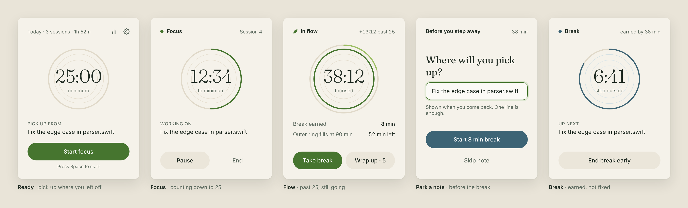
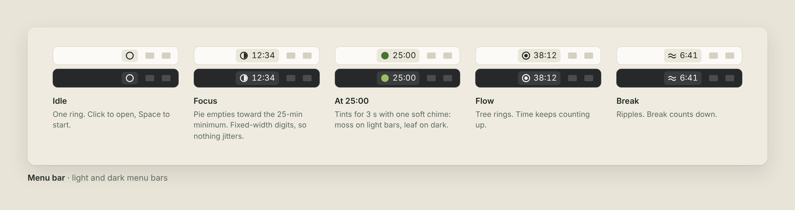
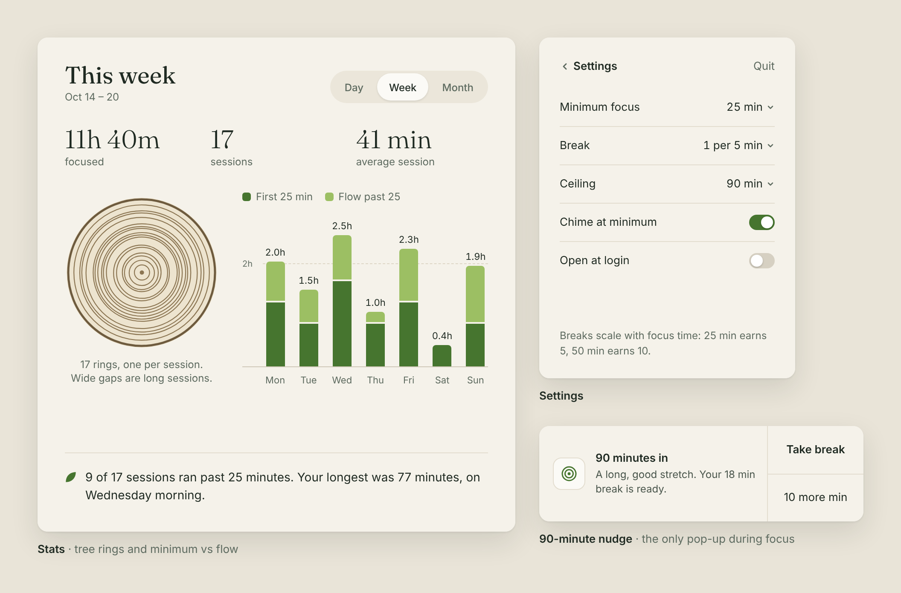

# Flow Pomodoro

A calm macOS menu bar timer that treats 25 minutes as a **minimum, not a maximum**.



- **Focus.** Start a 25-minute session. Committing to only 25 minutes makes starting easy.
- **Gentle cue.** At 25:00 the menu bar icon turns moss green for three seconds and one soft chime plays. Nothing pops up and nothing stops.
- **Flow.** If you ignore the cue, the timer keeps counting up. An outer ring grows toward the 90-minute ceiling.
- **Earned break.** Breaks scale with focus time at one minute per five minutes of focus: 25 min earns 5, 38 earns 8, 90 earns 18.
- **Wrap up.** Gives you five more minutes to finish the current thought.
- **Parking note.** Before a break, you write one line about where to pick up. It's shown during the break and when you come back.
- **Ceiling.** At 90 minutes you get a real notification ("Take break" / "10 more min"), repeated every 10 minutes.
- **Stats.** Day, week and month views: tree rings (one per session), a chart splitting the first 25 minutes from flow time, and a one-line insight.

## Design

Moss for focus, leaf green for flow time, river blue for breaks, on a warm paper background, with tree rings as the motif. The images are renders of the design mockups, which the app follows closely. The app itself uses Apple's system fonts (SF and New York) where the mockups use Inter and Fraunces.

**Menu bar.** A monochrome icon plus the time, legible on light and dark menu bars:



**Stats, Settings and the 90-minute nudge:**



## Requirements

- macOS 14 Sonoma or later
- Xcode 15.3 or later
- [XcodeGen](https://github.com/yonaskolb/XcodeGen) (`brew install xcodegen`)

## Build and run

```sh
cd FlowPomodoro
xcodegen generate
open FlowPomodoro.xcodeproj
```

Then press ⌘R in Xcode. The app lives in the menu bar only: no Dock icon and no main window. Allow notifications when asked; they're used only for the 90-minute ceiling, the end of a wrap-up and the end of a break.

Signing defaults to ad-hoc ("Sign to Run Locally"). To distribute the app or make "Open at login" reliable, set your team in `project.yml` (`DEVELOPMENT_TEAM`, `CODE_SIGN_STYLE: Automatic`) and regenerate.

## Tests

The timer state machine, break math, stats and history storage live in a plain Swift package with unit tests:

```sh
cd FlowCore
swift test
```

## Layout

```
project.yml                  XcodeGen spec (menu bar app, LSUIElement)
App/
  FlowPomodoroApp.swift      MenuBarExtra scene and menu bar label
  AppModel.swift             State, 1-second ticker, settings, persistence, sounds
  Notifier.swift             The few real notifications and their actions
  MenuBarIcon.swift          Drawn template icons: ring, pie, tree rings, ripples
  StatsWindowController.swift
  Theme.swift                Moss / wood / water palette, serif numerals
  Views/                     Ready, Focus, Flow, Park, Break, Settings, Stats
FlowCore/                    Pure logic package, tested with `swift test`
  Sources/FlowCore/
    TimerEngine.swift        idle → focusing (focus → flow) → parking → onBreak → idle
    FlowSettings.swift       Minimum, ratio, ceiling, wrap-up, re-nudge
    Stats.swift              Buckets, totals, insight line
    HistoryStore.swift       ~/Library/Application Support/FlowPomodoro/history.json
```

## Notes

- Time comes from wall-clock dates, not a counting timer, so sleep and wake are handled correctly. Wrap-up ends exactly at its deadline even if the Mac was asleep.
- Sessions shorter than a minute that are ended early aren't recorded.
- To quit, press ⌘Q while the panel is open, or use Settings → Quit. A session in progress is saved first.
- The serif is Apple's New York (`design: .serif`), the native stand-in for Fraunces in the design.
